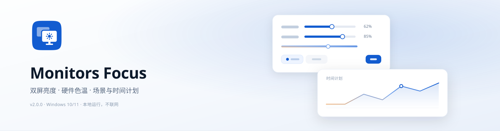
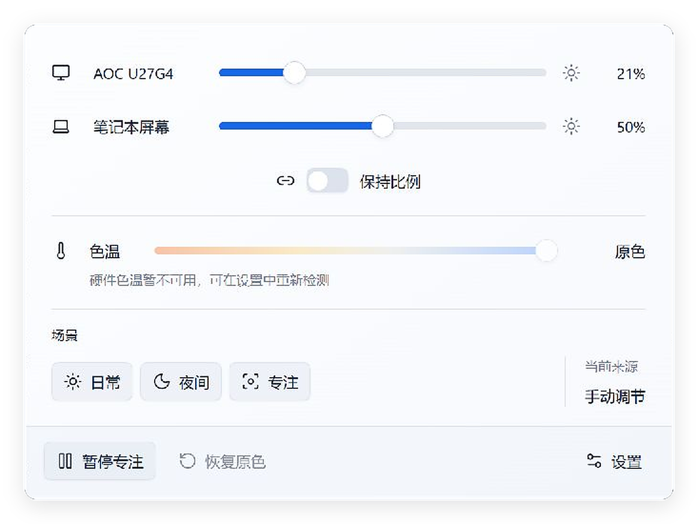
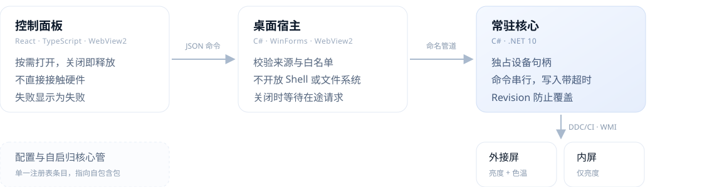

<p align="center"></p>

<br>

<p align="center">
  <a href="https://github.com/MaxMiksa/Monitors-Focus-Assistant/releases/tag/v2.0.0"></a>&nbsp;
  &nbsp;
  &nbsp;
  &nbsp;
  <a href="README.md"></a>
</p>

<p align="center">常驻内核负责硬件，控制面板按需打开。<br>两块屏幕的亮度、色温、场景和时间计划，都在同一个窗口里完成。</p>

## 它解决什么问题

Windows 只给一个整体亮度，外接屏和内屏分不开，色温要钻进显示器 OSD 一层层点。显示器各自的菜单还不一样，同一个操作在两块屏上手感完全不同。

Monitors Focus 把这些收进一个窗口：每块屏一条滑条直接写硬件背光，色温走 DDC/CI 的 RGB 增益，再把常用组合存成场景、把一天的节奏写成时间计划。界面上显示的是真实探测到的能力——内屏调不了色温就写「不支持」，不会给一个看起来能动、其实没生效的滑条。

## 控制面板

<p align="center"></p>

<p align="center"><sub>真实双屏：AOC U27G4 走 DDC/CI，笔记本内屏走 WMI。画面为目标亮度，硬件失败会单独提示。</sub></p>

## 功能

| 能力 | 说明 |
| --- | --- |
| 双屏亮度 | 每块屏独立滑条，直接写硬件背光；外接屏走 DDC/CI，内屏走 WMI |
| 保持比例绑定 | 为每屏设一个基准，之后同步调节按原比例走；归零后权重仍然保留 |
| 硬件色温 | 直接写 DDC/CI 的 RGB 增益（VCP `0x16` / `0x18` / `0x1A`），可一键恢复原色；仅限支持的外接屏 |
| 时间计划 | 按分钟设节点和渐变时长，跨午夜连续计算，亮度与色温各自按能力判断 |
| 场景 | 每个场景保存各屏的亮度和色温目标，面板一键切换，也能被时间计划引用 |
| 专注 | 空闲到设定时间后压到目标亮度，随时暂停，或交回计划接管 |
| 登录自启 | 只写一条 `MonitorsFocus` 注册表项，指向自包含内核，旧条目自动清理 |
| 面板按需 | 关闭面板只退出界面进程，内核继续调度；退出内核前先恢复临时调暗与色温 |

## 快速开始

1. 下载 [MonitorsFocus-v2.0.0-win-x64.zip](https://github.com/MaxMiksa/Monitors-Focus-Assistant/releases/download/v2.0.0/MonitorsFocus-v2.0.0-win-x64.zip) 并解压。
2. 运行 `desktop/MonitorsFocus.WebHost.exe`。`core/` 必须和 `desktop/` 同级保留，面板要靠它连内核。
3. 在设置里打开登录自启，注册项指向 `core/MonitorsFocus.exe --center --background`，开机后静默生效。

自包含包已含 .NET 运行时，只需要系统里的 Microsoft Edge WebView2 Runtime（Windows 11 通常预装）。

## 运行结构

<p align="center"></p>

- **设备句柄只由内核持有。** 面板拿不到硬件，也就不会出现两个进程抢同一块屏。
- **桥只开白名单。** 宿主校验消息来源和动作名，不暴露通用 Shell 或文件系统执行能力。
- **命令串行。** 等待超时不等于底层调用取消，释放句柄前必须等在途操作结束。

## 验证到什么程度

| 项目 | 状态 |
| --- | --- |
| 前端类型检查、生产构建、Oxlint | 通过，0 警告 0 错误 |
| 解决方案 Release 编译 | 通过，0 警告 0 错误 |
| 假设备生命周期检查（7 项） | 全部通过 |
| 双屏亮度读取 | 已验证（真实双屏） |
| 外屏硬件色温写入与恢复原色 | 已验证（AOC U27G4） |
| 比例绑定的真实硬件写入 | 待验收 |
| 长时间渐变、休眠与热插拔重连、混合 DPI 持续运行 | 待验收 |

当前开发版已移除新版和兼容旧版的全部应用快捷键，也不再规划场景快捷键。旧配置中的热键字段会被忽略，兼容入口下次保存时不再写入。

没验过的项就写「待验收」，不拿编译通过当成品验收。

## 文档

| 文档 | 内容 |
| --- | --- |
| [文档索引](docs/INDEX.md) | 全部文档的入口与分工说明 |
| [开发与构建](docs/development.md) | 目录职责、构建命令、浏览器预览、桌面桥、自启与打包 |
| [界面设计与核对](docs/design/README.md) | 设计规范、逐项还原核对与验收截图 |
| [运行时内存](docs/memory.md) | 核心与面板的实测口径、对比数据与优化路线 |
| [升级规划](docs/upgrade-plan-2026-10-30.md) | 审查证据、技术决策与阶段验收记录 |

## 从 v1.0.0 升级

先退出正在运行的旧版托盘进程，否则单实例锁会挡住新内核启动。旧配置在首次启动时迁移；不带 `--center` 启动仍进入 v1 的鼠标跟随遮罩模式，这条路只保证已有配置可用，不再新增功能。

## 参与开发

```powershell
./scripts/build.ps1
./src/MonitorsFocus.WebHost/bin/Release/net10.0-windows/MonitorsFocus.WebHost.exe
```

需要 .NET 10 SDK、Node.js 24 LTS 和 WebView2 Runtime。构建细节、浏览器预览与打包见[开发与构建](docs/development.md)。

## 许可与联系

MIT License。欢迎提交 Issue 和 Pull Request。

Zheyuan (Max) Kong · Carnegie Mellon University
[kongzheyuan@outlook.com](mailto:kongzheyuan@outlook.com) · [zheyuank@tepper.cmu.edu](mailto:zheyuank@tepper.cmu.edu)
