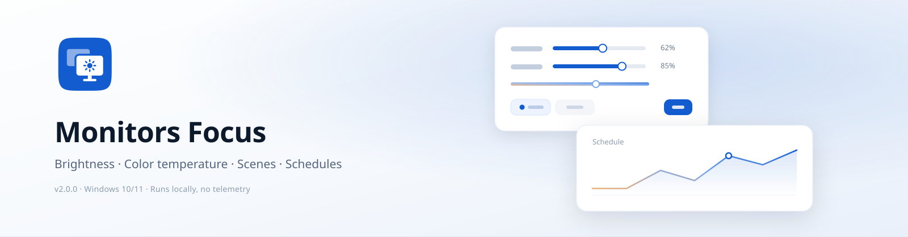
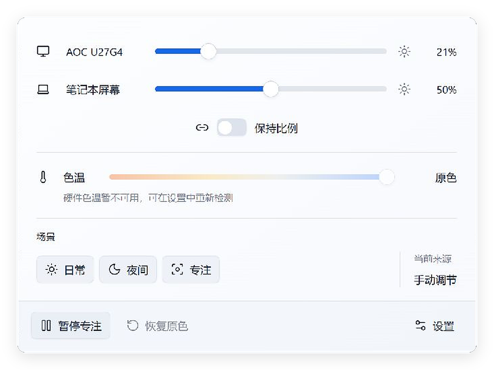
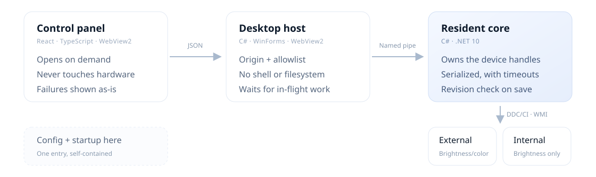

<p align="center"></p>

<br>

<p align="center">
  <a href="https://github.com/MaxMiksa/Monitors-Focus-Assistant/releases/tag/v2.0.0"></a>&nbsp;
  &nbsp;
  &nbsp;
  &nbsp;
  <a href="README-zh.md"></a>
</p>

<p align="center">A resident core owns the hardware. The panel opens when you need it.<br>Brightness, color, scenes and schedules for both displays, in one window.</p>

## The problem

Windows gives you one brightness slider for everything. Your external monitor and your laptop panel can't be separated, and color temperature lives three levels deep in an on-screen menu that differs per monitor.

Monitors Focus puts it in one window: a slider per display that writes the actual backlight, DDC/CI RGB gain for color, scenes for the combinations you reuse, and a schedule for how the day should look. The panel shows what was actually probed — if the internal display can't do color, it says so instead of offering a slider that moves and does nothing.

## The panel

<p align="center"></p>

<p align="center"><sub>Real hardware: AOC U27G4 over DDC/CI, laptop panel over WMI. Values are targets; hardware failures are reported separately.</sub></p>

## Features

| Capability | What it does |
| --- | --- |
| Per-display brightness | Independent slider per display, written straight to the backlight; DDC/CI for external, WMI for internal |
| Ratio binding | Set a baseline per display, then move both together at their original ratio; weights survive a zero |
| Hardware color | Writes DDC/CI RGB gain (VCP `0x16` / `0x18` / `0x1A`) with one-click restore; external panels only |
| Daily schedule | Per-minute nodes with fade duration, computed across midnight, brightness and color judged per capability |
| Scenes | Each scene stores per-display brightness and color targets; switch from the panel or reference it from the schedule |
| Focus | Dims to a target level after idle time; pause from the panel or tray, or hand control back to the schedule |
| Launch on startup | One `MonitorsFocus` registry entry pointing at the self-contained core; old entries cleaned up |
| On-demand panel | Closing the panel ends only the UI process; the core keeps scheduling and restores dimming and color before it exits |

## Quick start

1. Download [MonitorsFocus-v2.0.0-win-x64.zip](https://github.com/MaxMiksa/Monitors-Focus-Assistant/releases/download/v2.0.0/MonitorsFocus-v2.0.0-win-x64.zip) and extract it.
2. Run `desktop/MonitorsFocus.WebHost.exe`. Keep `core/` beside `desktop/`; the panel needs it to reach the core.
3. Turn on launch-at-startup in settings. The entry points at `core/MonitorsFocus.exe --center --background` and starts silently after login.

The package bundles the .NET runtime. You only need Microsoft Edge WebView2 Runtime, which ships with most Windows 11 installs.

## How it runs

<p align="center"></p>

- **Only the core holds device handles.** The panel cannot touch hardware, so two processes can never fight over the same display.
- **The bridge is an allowlist.** The host validates message origin and action names, and exposes no general shell or filesystem access.
- **Commands are serialized.** A wait timeout does not cancel the underlying call; handles are released only after in-flight work finishes.

## What is verified

| Item | Status |
| --- | --- |
| Type check, production build, Oxlint | Pass, 0 warnings 0 errors |
| Solution Release build | Pass, 0 warnings 0 errors |
| Fake-device lifecycle checks (7) | All pass |
| Dual-display brightness reads | Verified on real hardware |
| External color write and restore | Verified on AOC U27G4 |
| Ratio binding on real hardware | Pending |
| Long fades, resume and hot-plug reconnection, sustained mixed DPI | Pending |

The development build removes all application hotkeys in both modes; saved hotkey fields are ignored and omitted on the next legacy settings save. Scene hotkeys are no longer planned.

Unverified items stay marked pending. A clean build is not treated as acceptance.

## Documentation

| Document | Contents |
| --- | --- |
| [Index](docs/INDEX.md) | Entry point and a map of what lives where |
| [Development](docs/development.md) | Directory roles, build commands, browser preview, desktop bridge, startup, packaging |
| [Design and review](docs/design/README.md) | Design rules, item-by-item visual checks, acceptance screenshots |
| [Runtime memory](docs/memory.md) | Measured figures for core and panel, comparisons, optimisation path |
| [Upgrade plan](docs/upgrade-plan-2026-10-30.md) | Review evidence, technical decisions, stage acceptance |

## Upgrading from v1.0.0

Quit the old tray process first, or the single-instance lock will block the new core. Existing settings migrate on first start. Starting without `--center` still enters the v1 mouse-follow overlay mode; that path is kept working but frozen.

## Building

```powershell
./scripts/build.ps1
./src/MonitorsFocus.WebHost/bin/Release/net10.0-windows/MonitorsFocus.WebHost.exe
```

Requires .NET 10 SDK, Node.js 24 LTS and the WebView2 Runtime. See [development](docs/development.md) for browser preview and packaging.

## License and contact

MIT License. Issues and pull requests are welcome.

Zheyuan (Max) Kong · Carnegie Mellon University
[kongzheyuan@outlook.com](mailto:kongzheyuan@outlook.com) · [zheyuank@tepper.cmu.edu](mailto:zheyuank@tepper.cmu.edu)
