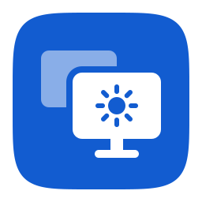
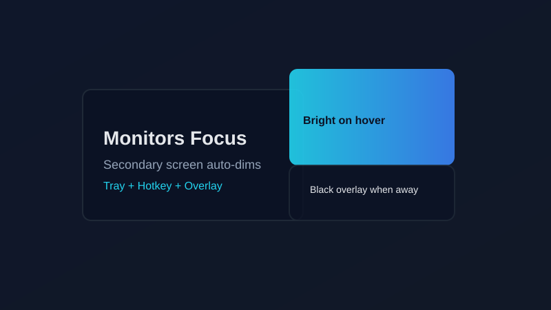
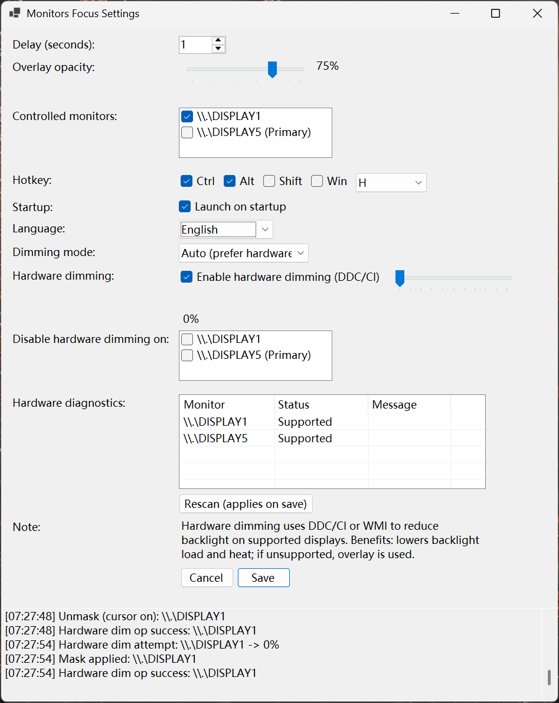
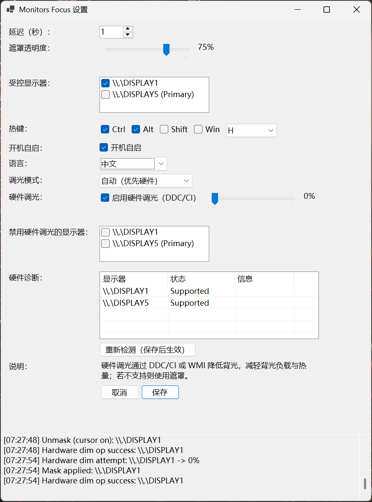

# Monitors Focus | [中文](README-zh.md)

  

✅ **Unified dual-display brightness | Ratio-locked binding | Local Windows app.**<br>
✅ **Daily schedule with fades | One-click scenes | Focus auto-dim**  
✅ **Persistent core + on-demand panel | Windows 10/11 | No window rearrange**  

Monitors Focus is a local Windows display control center. A resident core owns all DDC/CI and WMI hardware access; the panel opens on demand and releases itself when closed. Brightness, color temperature, scenes, and schedules for both displays live in one panel.

v2.0.0 rewrites the v1.0.0 tray overlay app as a two-layer product: a C# core plus a React/TypeScript interface. The v1 mouse-follow dimming path is still available as a compatibility entry point. See the [documentation index](docs/INDEX.md) and [visual checklist](docs/design/pages/controls.md) (Chinese).

<p align="center">
  <a href="https://github.com/MaxMiksa/Monitors-Focus-Assistant/releases/download/v2.0.0/MonitorsFocus-v2.0.0-win-x64.zip">
    
  </a>
</p>

## Features

| Feature | Description |
| :--- | :--- |
| 💡 Dual-display brightness | Independent slider per display, written straight to the backlight; WMI for the internal panel, DDC/CI for external ones. |
| ⚖️ Ratio binding | Set a baseline per display, then adjust both while keeping their brightness ratio; weights survive a zero. |
| 🌡️ Hardware color temperature | Writes DDC/CI RGB gain (VCP 0x16/0x18/0x1A) with one-click restore. External panels only. |
| 🕗 Daily schedule | Per-minute nodes with fade duration; brightness and color are evaluated independently per capability, across midnight. |
| 🎬 Scenes | Each scene stores per-display brightness and color targets; switch from the panel, or let the schedule reference it. |
| 🎯 Focus | Dims to a target level after idle time; pause anytime or hand control back to the schedule. |
| 🚀 Launch on startup | A single `MonitorsFocus` registry entry pointing at the self-contained core. |
| 🪟 On-demand panel | Closing the panel only ends the UI process; the core keeps scheduling. Quitting the core restores temporary dimming and color. |

<details>
  <summary>Legacy v1.0.0 overlay mode</summary>

  Started without `--center`, the app still runs the old tray overlay: pure black click-through mask, mouse-follow dimming, global pause hotkey (Ctrl+F12), live language switch. This path is frozen and only kept working for existing setups.
</details>

## Usage
1. Download `MonitorsFocus-v2.0.0-win-x64.zip`, extract, and run `desktop/MonitorsFocus.WebHost.exe`; keep `core/` next to `desktop/`.
2. Adjust both displays from the first panel screen; enable binding to move them together by ratio.
3. Configure schedule, scenes, focus, and startup in settings. The core takes over once saved, so closing the panel does not stop it.

<details>
  <summary>Requirements & Limits</summary>

  - Windows 10/11 x64. The self-contained package ships the .NET runtime; Microsoft Edge WebView2 Runtime is still required (preinstalled on most Windows 11).
  - Supports PerMonitorV2 DPI scaling on dual/multi-display layouts.
  - Brightness: DDC/CI for external displays, WMI for the internal panel. Capability follows each probe, never the brand.
  - Color temperature: hardware only, and the display's color preset must be set to "User". The internal panel reports unsupported instead of faking availability.
  - Not yet covered: long fades, resume and hot-plug reconnection, sustained mixed-DPI runs.
</details>

<p align="center">
  
  
</p>

## Related Info
<details>
  <summary>Requirements & Limits</summary>

  - Windows 10/11 (x64); self-contained publish includes runtime.
  - Designed for 2+ monitors; works with PerMonitorV2 DPI scaling.
  - Hardware dimming depends on monitor support (DDC/CI external displays; WMI for many laptops); otherwise overlay is used.
</details>

<details>
  <summary>Developer Guide</summary>

  ```powershell
  ./scripts/build.ps1
  ./src/MonitorsFocus.WebHost/bin/Release/net10.0-windows/MonitorsFocus.WebHost.exe
  ./scripts/build.ps1 -Package
  ```

  [Development / 开发与构建](docs/development.md)
</details>

<details>
  <summary>Development Stack</summary>

  1. Packages & Frameworks: .NET 10, WebView2, React, Tailwind CSS, shadcn/ui, Motion, Lucide
  2. Interfaces & Services: Windows user32 APIs (`RegisterHotKey`, layered windows)
  3. Languages: C#, TypeScript
</details>

<details>
  <summary>License</summary>

  License: MIT.
</details>

<details>
  <summary>FAQ / Troubleshooting</summary>

  - Hotkey not working? Another app may own it—change the hotkey in Settings.
  - Secondary not dimming? Check the monitor checklist in Settings. Set the delay to 0 for immediate dimming after the cursor leaves that monitor.
  - Overlay steals focus? Overlays are non-activating (`WS_EX_NOACTIVATE`); if you still see focus issues, try pausing/resuming via hotkey to reset.
</details>

## 🤝 Contribution & Contact

Welcome to submit Issues and Pull Requests!
Any questions or suggestions? Please contact Zheyuan (Max) Kong (Carnegie Mellon University, Pittsburgh, PA).

Zheyuan (Max) Kong: kongzheyuan@outlook.com | zheyuank@tepper.cmu.edu
GitHub: https://github.com/MaxMiksa/Monitors-Focus-Assistant
